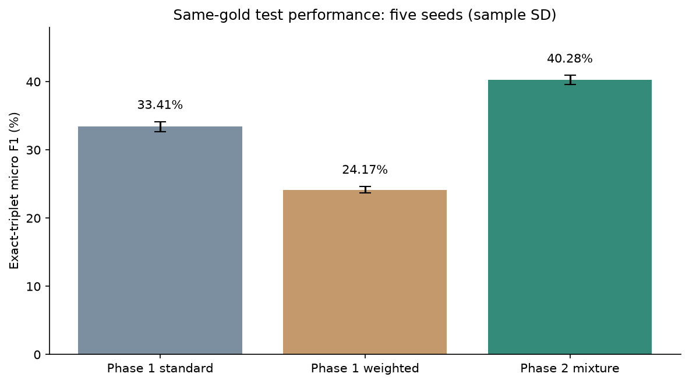
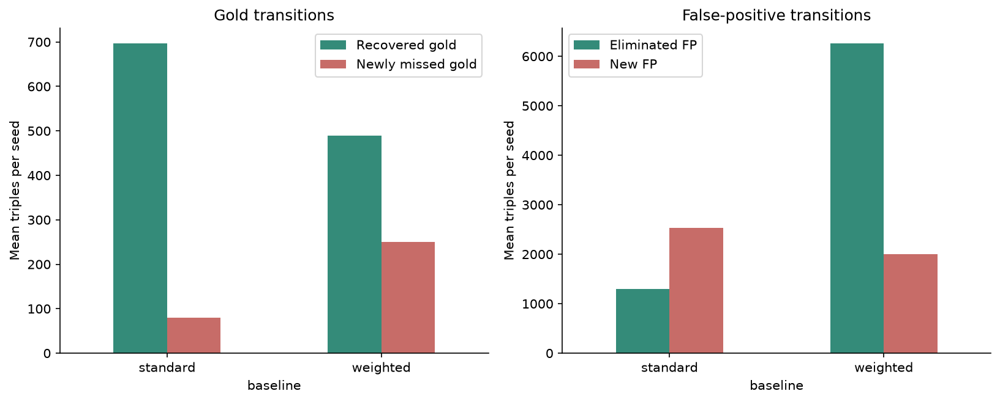
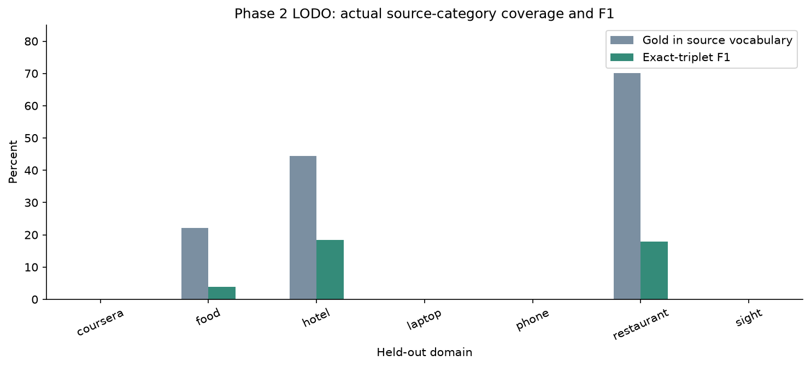
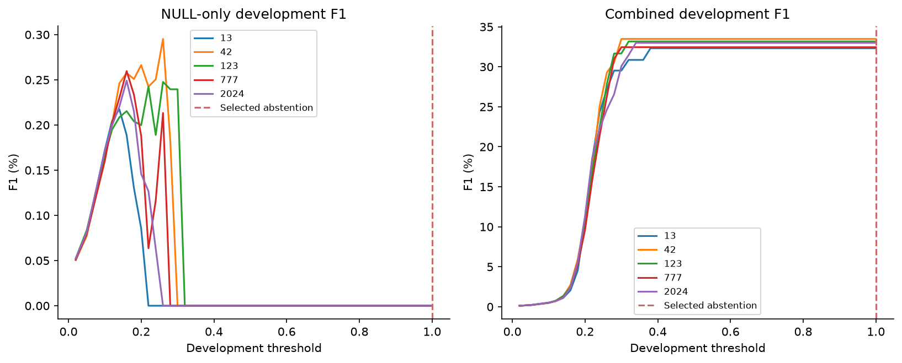

# Final evaluation and error analysis

Completed presentation cohorts only; no training or parameter selection from tests.

All F1/precision/recall columns ending in pct are percentages; SD is across five seeds.

## Same-gold in-domain test performance

| model | precision_pct | recall_pct | f1_pct | f1_sd_pp | mean_tp | mean_fp | mean_fn |
| --- | --- | --- | --- | --- | --- | --- | --- |
| standard | 34.879 | 32.071 | 33.407 | 0.751 | 1195.6 | 2233.2 | 2532.4 |
| weighted | 16.938 | 42.183 | 24.167 | 0.488 | 1572.6 | 7718.4 | 2155.4 |
| mixed | 34.389 | 48.627 | 40.285 | 0.661 | 1812.8 | 3458.6 | 1915.2 |

## Mean prediction transitions per seed

| baseline | recovered | newly_missed | persistent_miss | correct_both | eliminated_fp | new_fp | delta_tp | delta_fp | gain_pp | gain_sd_pp |
| --- | --- | --- | --- | --- | --- | --- | --- | --- | --- | --- |
| standard | 696.4 | 79.2 | 1836.0 | 1116.4 | 1301.8 | 2527.2 | 617.2 | 1225.4 | 6.878 | 0.62 |
| weighted | 490.0 | 249.8 | 1665.4 | 1322.8 | 6257.4 | 1997.6 | 240.2 | -4259.8 | 16.118 | 1.043 |

## Same-gold LODO baseline comparison (%)

| domain | phase1_standard | phase1_weighted | phase2_mixed_025 | coverage_pct |
| --- | --- | --- | --- | --- |
| coursera | 0.0 | 0.0 | 0.0 | 0.0 |
| food | 4.447 | 2.211 | 3.796 | 22.111 |
| hotel | 16.894 | 13.198 | 18.376 | 44.495 |
| laptop | 0.0 | 0.0 | 0.0 | 0.0 |
| phone | 0.0 | 0.0 | 0.0 | 0.0 |
| restaurant | 13.122 | 20.316 | 17.819 | 70.172 |
| sight | 0.0 | 0.0 | 0.0 | 0.0 |

## Phase 2 LODO coverage and component scores

| domain | gold | covered_gold | uncovered_gold | coverage_pct | exact_f1_pct | term_f1_pct | term_category_f1_pct | term_sentiment_f1_pct |
| --- | --- | --- | --- | --- | --- | --- | --- | --- |
| coursera | 351 | 0 | 351 | 0.0 | 0.0 | 53.225 | 0.0 | 47.733 |
| food | 199 | 44 | 155 | 22.111 | 3.796 | 40.281 | 5.105 | 33.282 |
| hotel | 436 | 194 | 242 | 44.495 | 18.376 | 53.096 | 18.991 | 50.578 |
| laptop | 494 | 0 | 494 | 0.0 | 0.0 | 53.993 | 0.0 | 49.194 |
| phone | 1089 | 0 | 1089 | 0.0 | 0.0 | 31.532 | 0.0 | 29.279 |
| restaurant | 523 | 367 | 156 | 70.172 | 17.819 | 53.296 | 19.322 | 49.585 |
| sight | 636 | 0 | 636 | 0.0 | 0.0 | 42.524 | 0.0 | 36.059 |

## Source-training rarity and in-domain recall

| rarity | gold | correct | term | category | sentiment | recall_pct | missed | share_of_misses_pct |
| --- | --- | --- | --- | --- | --- | --- | --- | --- |
| unseen | 14.0 | 0.0 | 7.2 | 6.8 | 0.0 | 0.0 | 14.0 | 0.731 |
| rare | 180.0 | 2.8 | 65.8 | 110.6 | 0.8 | 1.556 | 177.2 | 9.252 |
| low | 359.0 | 49.4 | 133.6 | 171.2 | 4.8 | 13.76 | 309.6 | 16.165 |
| medium | 1113.0 | 502.4 | 355.8 | 213.0 | 41.8 | 45.139 | 610.6 | 31.882 |
| frequent | 2062.0 | 1258.2 | 576.4 | 126.6 | 100.8 | 61.018 | 803.8 | 41.97 |

## Interpretation

LODO: 3123/3728 gold triples (83.77%) have categories absent from their own Phase 2 source vocabulary.

The newer NULL adaptation abstained; the historical BCE head recovered some pairs but reduced combined F1 against its own control.

These are exploratory pipeline comparisons, not a loss-only causal effect or a fresh confirmatory test.

The ongoing optional 120-model class-balanced extension is excluded from these completed presentation results.

## Figures

